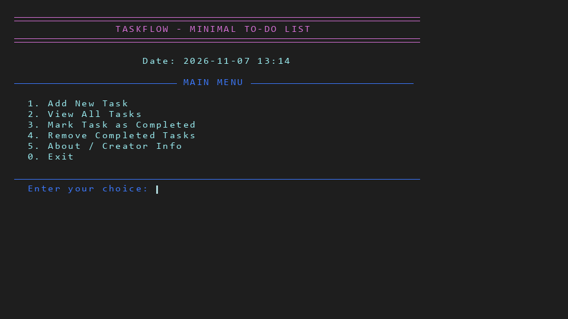
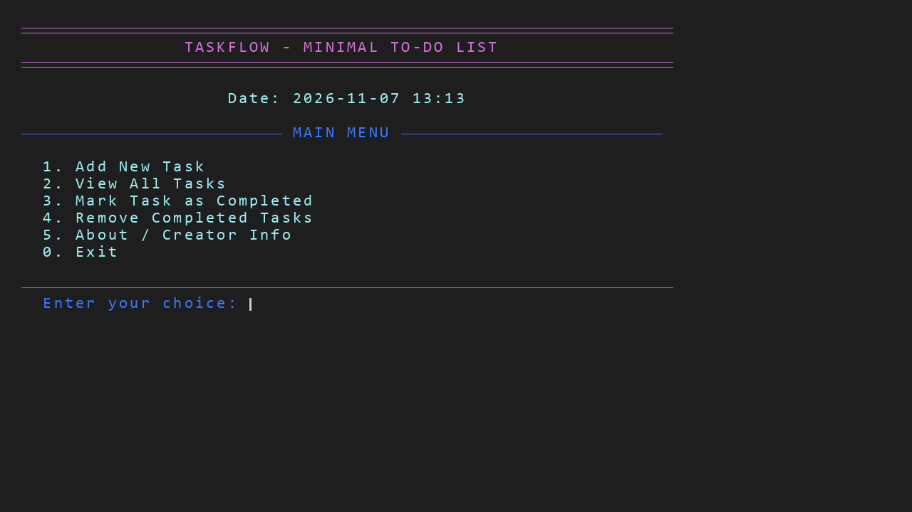
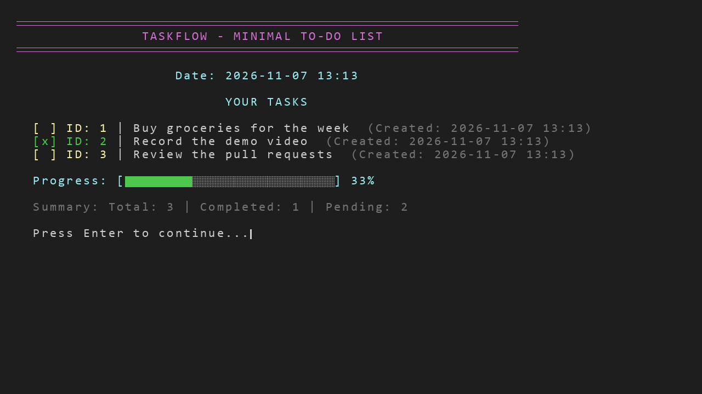

# TaskFlow — Console To-Do List (C++17)

A colorful, menu-driven to-do manager for the terminal. Add tasks, mark them
complete, track your progress, and remove finished items — all from a single
C++17 source file with no external dependencies.

<p align="center">
  <a href="https://github.com/ShahabAhmed01/To-Do-List-Application/actions/workflows/ci.yml"></a>
  
  
</p>

<p align="center">
  
</p>

<p align="center">
  
  
</p>

## Features

- Add new tasks with automatic timestamps
- View all tasks in a formatted list
- Mark tasks as completed
- Remove a task by ID — pending tasks require confirmation
- Remove completed tasks in bulk
- **Progress bar** for completion ratio
- Colored console UI on **Windows** and **Linux**

## Limitations

TaskFlow is intentionally small. It currently does **not**:

- Save tasks between sessions — everything is held in memory and is lost when
  the program exits
- Edit an existing task description
- Support due dates, priorities, tags, or categories
- Import or export task data

Persistence is the most significant missing capability: closing the program
discards every task.

## Roadmap

Follow-up work is tracked in the issue tracker:

- [Persist tasks between sessions](https://github.com/ShahabAhmed01/To-Do-List-Application/issues/2)
- [Allow editing a task description](https://github.com/ShahabAhmed01/To-Do-List-Application/issues/3)
- [Allow removing pending tasks](https://github.com/ShahabAhmed01/To-Do-List-Application/issues/4)

## Requirements

- A C++17 compiler (GCC, Clang, or MSVC)
- No third-party libraries

The project is tested in CI with GCC on Ubuntu and MSVC on Windows. Other
POSIX systems are likely to work but are not covered by CI.

## Build and run

### Windows (MinGW / g++)

```powershell
g++ -std=c++17 -O2 -o taskflow.exe "To-Do List Application.cpp"
.\taskflow.exe
```

### Windows (MSVC)

From a Developer Command Prompt:

```bat
cl /nologo /std:c++17 /EHsc /utf-8 /W4 "To-Do List Application.cpp" /Fe:taskflow.exe
taskflow.exe
```

### Linux (g++)

```bash
g++ -std=c++17 -O2 -Wall -Wextra -Wpedantic -Werror -o taskflow "To-Do List Application.cpp"
./taskflow
```

## Usage

The app presents a numbered menu:

| Option | Action |
| --- | --- |
| `1` | Add a new task |
| `2` | View all tasks, progress, and summary |
| `3` | Mark a task as completed |
| `4` | Remove completed tasks |
| `5` | About / creator info |
| `0` | Exit |

Task state is stored in memory only. Exiting the program discards all tasks.

## Tests

The repository includes scripted end-to-end smoke tests that drive the built
binary with real input sequences.

Linux:

```bash
g++ -std=c++17 -O2 -o taskflow "To-Do List Application.cpp"
bash tests/smoke_test.sh ./taskflow
```

Windows (PowerShell):

```powershell
g++ -std=c++17 -O2 -o taskflow.exe "To-Do List Application.cpp"
pwsh -File tests/smoke_test.ps1 -Binary ./taskflow.exe
```

The tests cover quitting, adding and completing a task through the full flow,
and invalid numeric input. They pass locally on Windows with MinGW GCC 16.2.0
and are run by GitHub Actions on Ubuntu and Windows.

## CI

`.github/workflows/ci.yml` builds the project and runs the smoke tests on
Ubuntu (GCC) and Windows (MSVC) for pushes to `main` and pull requests.
Dependabot checks for GitHub Actions updates monthly.

## Project structure

```text
.
├── .github/
│   ├── dependabot.yml
│   ├── ISSUE_TEMPLATE/
│   ├── pull_request_template.md
│   └── workflows/ci.yml
├── demo-assets/
│   ├── demo.gif
│   ├── make_social_preview.py
│   ├── record_demo.py
│   ├── social-preview.png
│   └── screenshots/
├── tests/
│   ├── smoke_test.ps1
│   └── smoke_test.sh
├── .gitignore
├── CHANGELOG.md
├── CODE_OF_CONDUCT.md
├── CONTRIBUTING.md
├── LICENSE
├── README.md
├── SECURITY.md
└── To-Do List Application.cpp
```

## Demo assets

The screenshots and GIF are captured from the real program running in a
Windows pseudo-terminal — not mocked up. See [`demo-assets/README.md`](demo-assets/README.md)
for the capture tooling and regeneration commands.

## Contributing

Contributions are welcome. See [`CONTRIBUTING.md`](CONTRIBUTING.md) for build
steps, test commands, and pull request expectations, and
[`CODE_OF_CONDUCT.md`](CODE_OF_CONDUCT.md) for community expectations.

For security issues, please follow [`SECURITY.md`](SECURITY.md) instead of
opening a public issue.

## License

MIT — see [LICENSE](LICENSE).

## Author

**Shahab Ahmed** — [GitHub](https://github.com/ShahabAhmed01) ·
[LinkedIn](https://www.linkedin.com/in/shahabahmed01/) ·
[Portfolio](https://shahabahmed01.github.io)
